北馆开馆已三年，一直提不起兴趣走一趟。因为近三十年传统意义的图书馆功能性已发生翻天覆地的变化，”图书馆之城“应该随着媒介的变化而变化才对，建这些宏大建筑意义有多大？但，终归还是要到此一游，看看体量与气派下的内涵如何？
不出所料，馆内大半空间为阅读座位，座位上在阅览馆内图书文献的估计不超5%，绝大多少人自带图书、电脑、饮料，把那里当成公共沉浸式空间，比星巴克可以更长时间更自在占座。虽然这个现象至少二十年前已然，但北馆空间配比更多。
意外发现，从中庭到扶手电梯1-5层两侧顶天立地的陈列书架，几乎全是摆放着英文为主的原版小说等书籍，有身处外文图书馆之感。
可供现场借阅的图书，粗略看了两三个门类，某些门类的图书少得不能再少。看书借书，还得到市民中心的馆去，或者大学城图书馆。

隔壁的美术馆观感也有大落差。展厅缺艺术感，逛了两三个主题展，布展极其随意、简陋。

两馆游走加拍照，共花30+15分钟.估计应该不会再去，除非必须陪游。

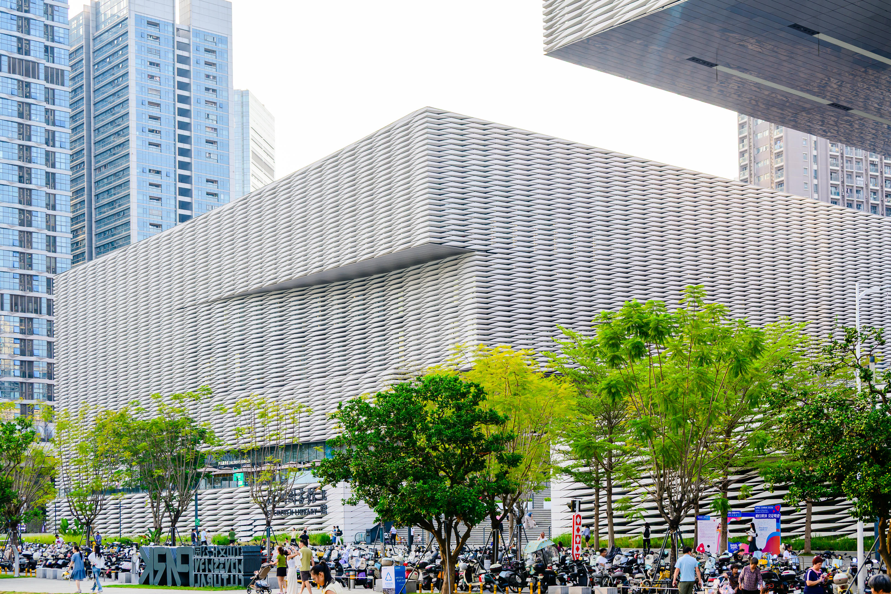

座无虚席
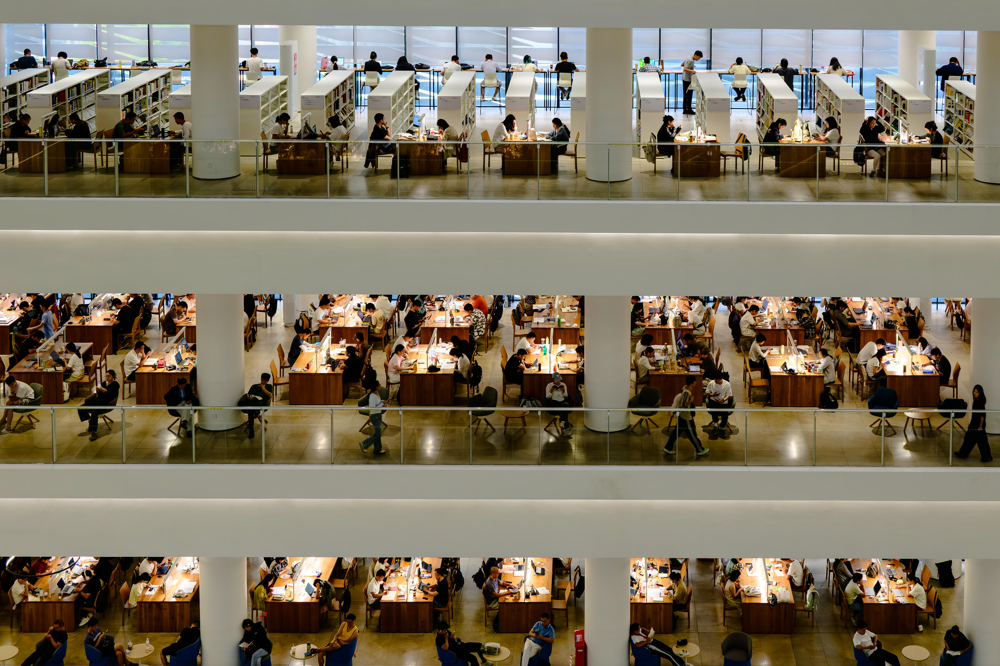

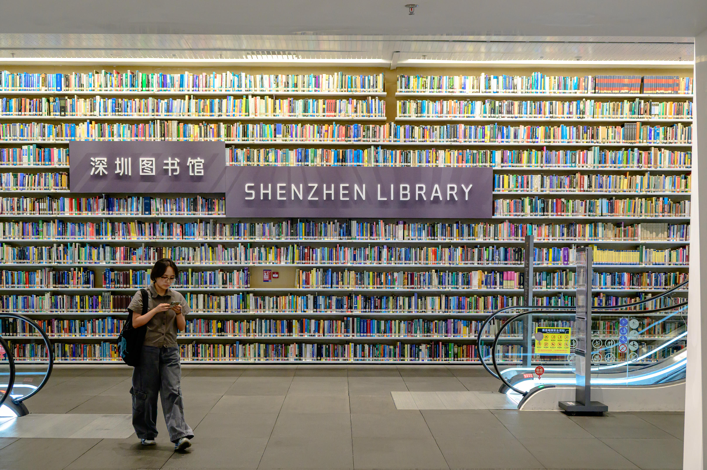

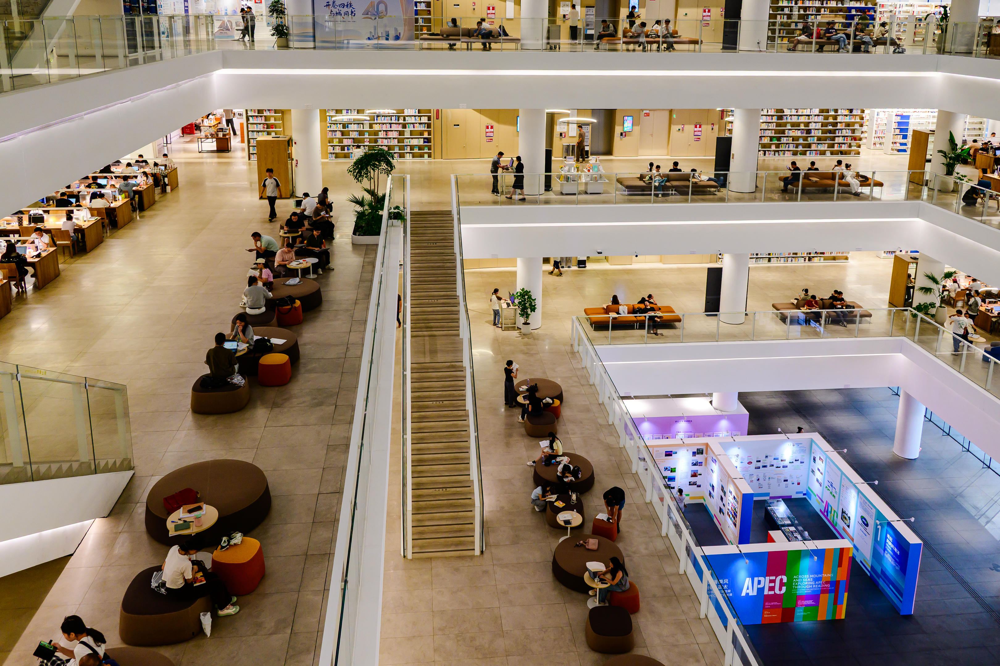

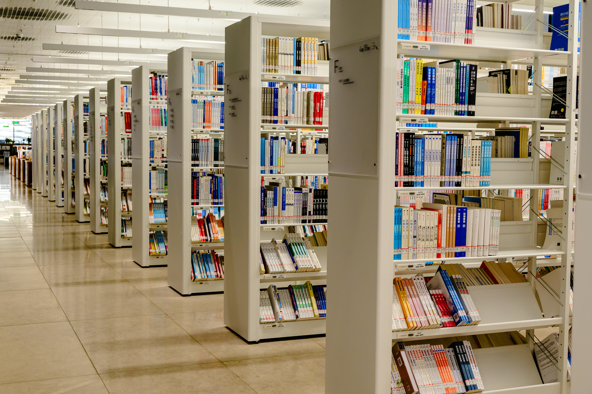

基督教图书
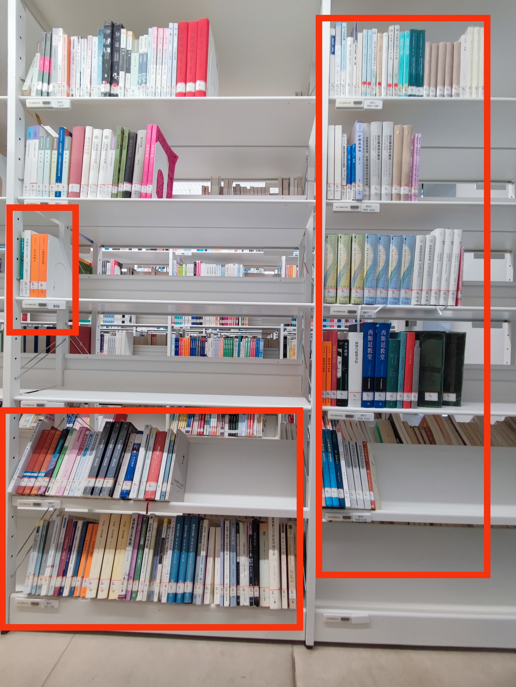

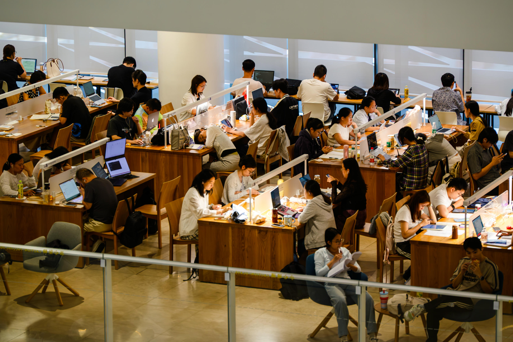

基本英语为主的外文书

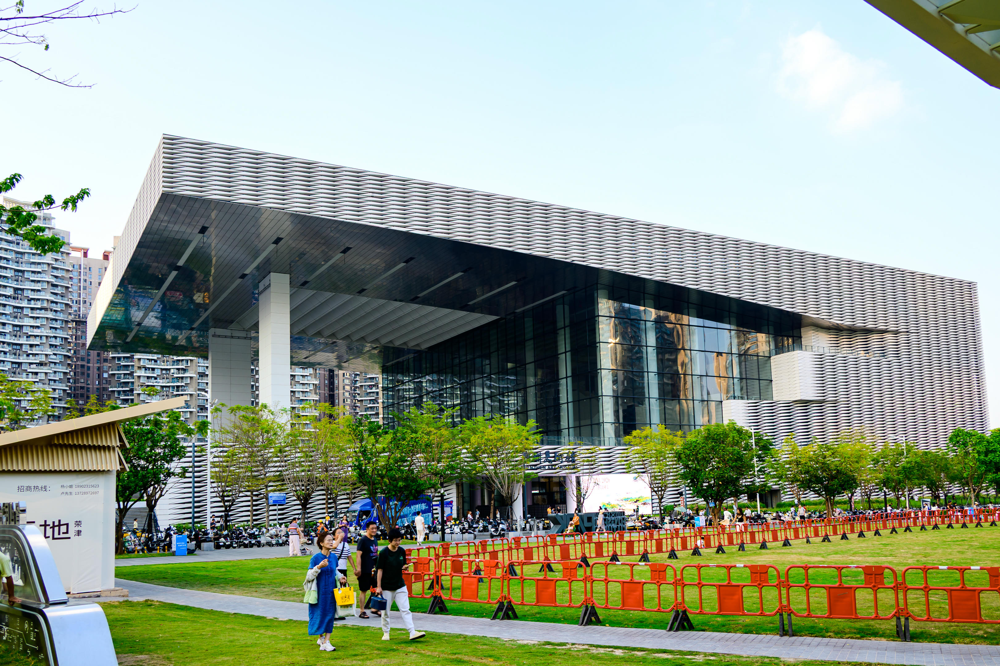

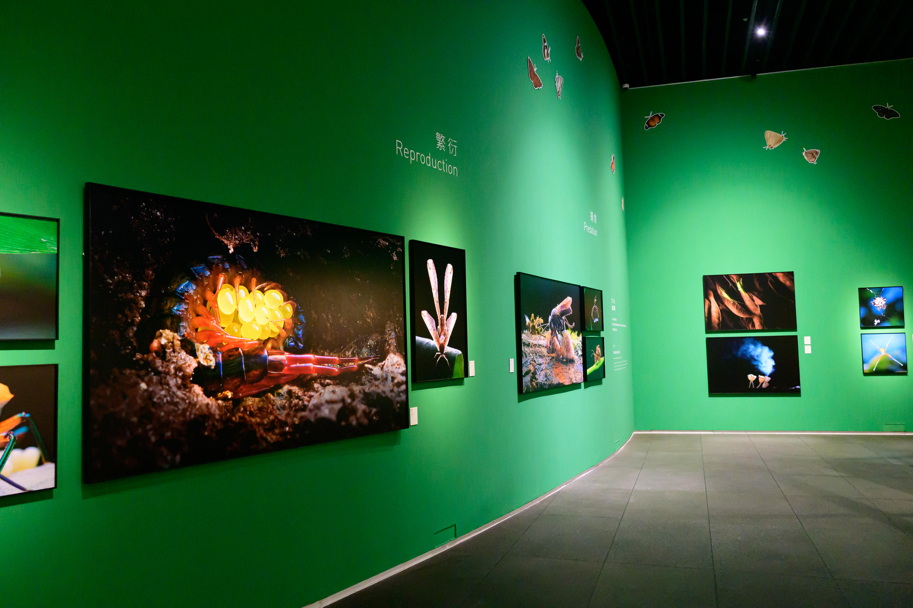

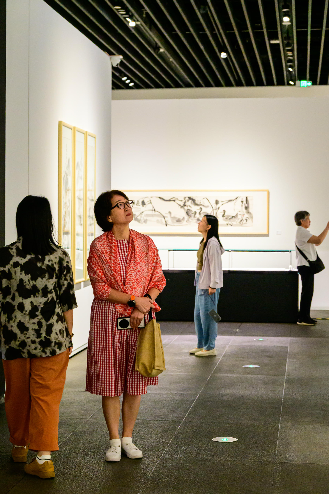

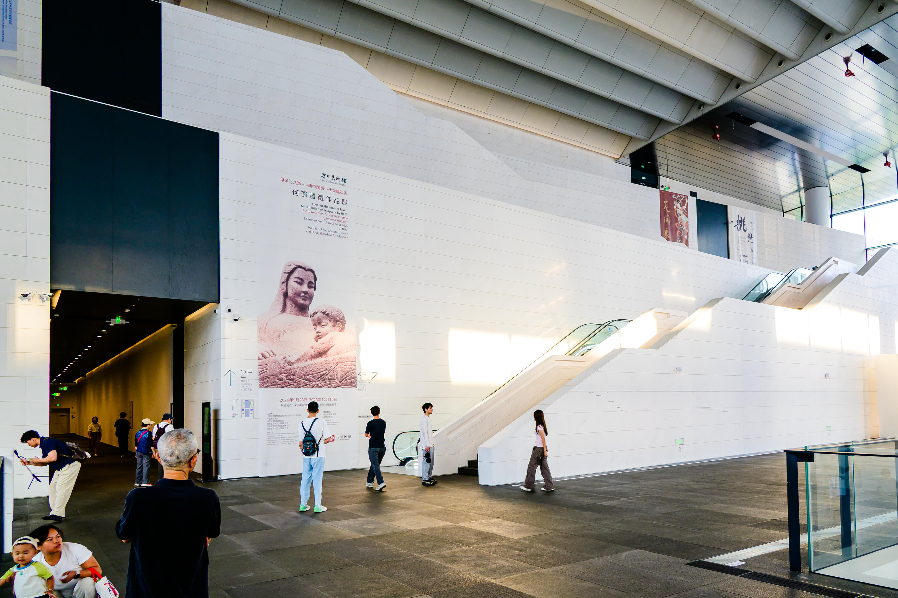

